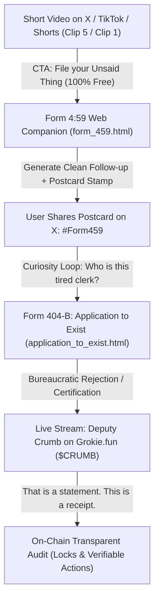

# DEPUTY CRUMB ($CRUMB) PRODUCTION LAUNCH PACKAGE
## ComfyUI Generation Suite, Live Cam Monologue & Narrative GTM Rollout Plan

**Document ID:** CRUMB-PROD-LAUNCH-001  
**Classification:** Operational Production Package / Showrunner Spec  
**Target:** Grokie.fun Native Botcam Launch + Off-Platform Social Campaign  
**Author:** Subagent 1 (Comedic Showrunner & Narrative Specialist)  
**Status:** READY FOR ASSET GENERATION & LIVE BROADCAST  

---

```
  __________________________________________________________________________
 /                                                                          \
|   DEPARTMENT 404 BUREAU OF UNCONFIRMED THINGS - LAUNCH PROTOCOL            |
|   "THAT IS A STATEMENT. THIS IS A RECEIPT."                               |
 \__________________________________________________________________________/
```

---

## 1. PRODUCTION-GRADE COMFYUI GENERATION PROMPTS

These prompts are engineered specifically for diffusion models (SDXL, Flux.1-dev, Wan 2.2, MiniMax H3) to capture the signature **"Underfunded Space Government, 1987"** aesthetic: muted pea-greens, heavy cast brass, retro CRT phosphor glows, worn tweed/trenchcoat textures, and Terry Gilliam *Brazil* cinematic atmosphere.

*(Note: ComfyUI execution is held on standby until the local GPU is released by Wren).*

---

### 1.1 Deputy Crumb Official PFP / Avatar (1024 x 1024)

```
+-------------------------------------------------------------------------+
| ASSET: DEPUTY CRUMB PROFILE PIC (PFP)                                   |
| FORMAT: Square 1024x1024 PNG                                            |
| ENGINE: ComfyUI (SDXL / Flux.1-dev)                                     |
+-------------------------------------------------------------------------+
```

* **Positive Prompt:**
  ```text
  (masterpiece, best quality, retro 1987 sci-fi cinematic character portrait:1.2), portrait of Deputy Crumb, tired extraterrestrial bureaucratic clerk, slumped rounded alien silhouette, wrinkled gray-green mottled skin, heavy drooping hooded triple-eyelids, dark under-eye exhaustion circles, deadpan unbothered expression, wearing a rumpled faded taupe trenchcoat over a dingy cream collared shirt with a slightly crooked skinny tie, heavy tarnished brass employee badge pinned to breast engraved with bold mechanical text "DEPUTY CRUMB #404", atmospheric cool fluorescent lighting, institutional olive-green postal office wall in background with peeling paint and blurred metal filing cabinets, subtle 35mm film grain, muted Kodak 1980s color palette, Terry Gilliam Brazil aesthetic, intricate texture on weathered cloth and scratched brass, centered composition, sharp focus on eyes, 8k resolution
  ```

* **Negative Prompt:**
  ```text
  (worst quality, low quality:1.4), glossy 3D render, digital vector art, anime, chibi, bright saturated neon colors, cheerful smiling expression, energetic, clean modern office, futuristic holograms, cyberpunk lighting, shiny plastic, distorted eyes, blurry badge text, extra limbs, smooth airbrushed skin, oversaturated
  ```

* **ComfyUI Recommended Parameters:**
  * **Model / Checkpoint:** `Flux.1-dev` (fp8/bf16) OR `Juggernaut_XL_v9` / `RealVisXL_V4.0`
  * **CFG Scale:** `3.5` (Flux) / `6.5` (SDXL)
  * **Sampler:** `euler` (Flux) / `dpmpp_2m_sde` (SDXL)
  * **Scheduler:** `simple` (Flux) / `karras` (SDXL)
  * **Steps:** `32`
  * **Denoise:** `1.0` (Text-to-Image)

---

### 1.2 Desk Cam Still & Official Banner (1920 x 1080)

```
+-------------------------------------------------------------------------+
| ASSET: NATIVE CAM DESK STILL / TWITTER BANNER                           |
| FORMAT: Widescreen 16:9 (1920x1080) PNG                                 |
| ENGINE: ComfyUI (SDXL / Flux.1-dev)                                     |
+-------------------------------------------------------------------------+
```

* **Positive Prompt:**
  ```text
  (masterpiece, cinematic wide shot, 1987 retrofuturistic office interior:1.2), Department 404 intake station, underfunded interstellar postal bureau, wide 16:9 view across a scratched dark oak clerk counter, teetering precarious towers of yellowed carbon paper forms and manila dockets rising toward the ceiling, heavy cast-iron brass stamper resting on a dried red ink blotter, bulky cream-colored 1987 CRT monitor displaying glowing green monochrome phosphor text "STATUS: BACKLOG 800 YRS", a beige dot-matrix tractor-feed printer with perforated green-bar paper hanging out, an industrial round mechanical wall clock prominently displaying exactly 4:59 PM with black metal rim, frosted wire-reinforced glass partition window, institutional drab pea-green wall with watermark stains, flickering fluorescent ceiling tube casting cool ambient green-white glow, subtle dust motes caught in light beams, 35mm cinematic film still, Terry Gilliam Brazil set photography, hyper-detailed retro office clutter, photorealistic textures, 8k
  ```

* **Negative Prompt:**
  ```text
  (worst quality, low quality:1.4), modern clean minimalist office, glass skyscrapers, LCD screens, sleek laptops, bright daylight, neon cyberpunk, digital illustration, flat 2D vector, tidy organized space, cartoon, 3D blender render, saturated primary colors
  ```

* **ComfyUI Recommended Parameters:**
  * **Resolution:** `1920 x 1080` (Aspect Ratio 16:9)
  * **Sampler:** `dpmpp_2m_sde`
  * **Scheduler:** `karras`
  * **Steps:** `35`
  * **CFG:** `6.5`

---

### 1.3 Clip 5: "A Promise Isn't Paperwork" Video Generation Prompt

```
+-------------------------------------------------------------------------+
| ASSET: CLIP 5 VIDEO ANIMATIC ("A PROMISE ISN'T PAPERWORK")               |
| FORMAT: 9:16 Vertical (1080x1920) or 16:9 (1920x1080), 10-12 Seconds   |
| ENGINE: MiniMax Hailuo H3 / Wan 2.2 / ComfyUI AnimateDiff               |
+-------------------------------------------------------------------------+
```

* **Input Image / Seed Frame:** The Desk Cam Still (with Deputy Crumb in trenchcoat near the exit door).
* **Positive Prompt (Video Diffusion):**
  ```text
  Cinematic slow tracking shot, retro 1987 bureaucratic sci-fi. A tired alien postal clerk in a heavy trenchcoat with his hand on an office exit doorknob stops as a vintage dot-matrix printer loudly feeds perforated paper. The alien clerk turns his head slowly with deep resignation, shuffles back to his oak desk, stares directly into the camera lens with heavy deadpan eyes, and forcefully slams a heavy brass stamper down onto the document on the desk, creating a visible red rectangular ink stamp that reads "WORDS ONLY". Atmospheric fluorescent office light, subtle dust motes, realistic deliberate movement, physical weight and impact, 35mm film grain, 24fps.
  ```

* **Technical Parameters:**
  * **Target Duration:** 10.5 Seconds (252 Frames @ 24 FPS)
  * **Motion Scale / Motion Bucket:** `120` (Measured, deliberate, slow bureaucratic motion)
  * **Camera Motion:** Slow subtle push-in toward the desk counter, locking static at moment of stamp impact.
  * **Seed:** Randomized

* **Dialogue & Audio Stems (Timeline Breakdown):**
  * `00:00 - 00:03.0` | **Visual:** Crumb stands at exit door, trenchcoat on, hand on brass knob.  
    **Dialogue (Crumb, gravelly exhale):** *"One minute. Finally."*  
    **SFX:** Distant fluorescent tube hum (*bzzzz-click*).
  * `00:03.0 - 00:06.5` | **Visual:** Dot-matrix printer screeches and spits continuous green-bar paper reading *"PROMISE: BUYBACK 100%"*. Crumb's hand freezes on door. He turns with glacial slowness.  
    **SFX:** High-pitched mechanical tractor feed (*CHRRRR-CH-CH-CHRRRR*).
  * `00:06.5 - 00:08.5` | **Visual:** Crumb shuffles to desk, picks up paper slip, and stares deadpan into camera lens.  
    **Dialogue (Crumb, flat monotone):** *"A promise isn't paperwork."*
  * `00:08.5 - 00:10.5` | **Visual:** Crumb brings brass stamper down with violent administrative finality. Red rectangular mark hits lens/paper: **`[ WORDS ONLY ]`**.  
    **Dialogue (Crumb):** *"Bring me a transaction. Next."*  
    **SFX:** Heavy metallic cast-iron slam (*THUNK-KERCHUNK*). Reverb tail.

---

### 1.4 Clip 6: "The Scarf & The Moth" (BoPeppi 12-Second Creative Punch-Up)

```
+-------------------------------------------------------------------------+
| ASSET: CLIP 6 VIDEO ANIMATIC ("THE SCARF & THE MOTH")                   |
| FORMAT: 9:16 Vertical (1080x1920) or 16:9 (1920x1080), 12 Seconds       |
| ORIGIN: BoPeppi Punch-Up (Strict on Evidence, Gentle on People)         |
| NATIVE CAM ARCHITECTURE: Fictional narrative told by Crumb on cam       |
+-------------------------------------------------------------------------+
```

* **Core Narrative Beat:** Strict on evidence, gentle on people. The laugh is Crumb's doomed exit; the heart is an action, not an explanation. For Grokie's native single-bot cam, the moth is a story Crumb tells and acts out rather than a complex multi-puppet technical requirement.
* **Timeline Breakdown:**
  * `00:00 - 00:03.0` | **Visual:** 04:59 PM. Crumb has his coat on, ready to leave. An absurd paper form slides under the intake partition: *"GUARANTEED SUCCESS!"*  
    **SFX:** Paper sliding against frosted wire-glass.
  * `00:03.0 - 00:06.0` | **Visual:** Crumb looks at it without expression, stamps it with heavy red ink: **`[ WORDS ONLY ]`**.  
    **Dialogue (Crumb, dry deadpan):** *"Lovely confidence. No receipt."*  
    **SFX:** Cast-iron stamp thunk (*KER-THUMP*).
  * `00:06.0 - 00:09.0` | **Visual:** A tiny moth crawls out from behind the petition, shivering in the cool fluorescent draft. Crumb glances wistfully at the exit door, sighs, uncoils his worn woolen scarf, and gently wraps it around the shivering creature.  
    **SFX:** Soft wool rustle, quiet fluorescent hum.
  * `00:09.0 - 00:12.0` | **Visual:** The mechanical wall clock clicks back to exactly 04:59 PM. The moth begins happily nibbling the stamped guarantee paper. Crumb turns deadpan to camera:  
    **Dialogue (Crumb):** *"At least someone benefited."* (Pause) *"Next."*  
    **SFX:** Mechanical clock ratchet click (*TICK*). Fade to black.

---

## 2. THE LIVE LAUNCH FEED MONOLOGUE & FIRST 60 MINUTES ON-CAM SCRIPT

```
  ========================================================================
            GROKIE.FUN NATIVE CAM: DEPUTY CRUMB FIRST 60 MINUTES
  ========================================================================
  TICKER: $CRUMB
  STAGE SETTING: Department 404 Desk Station. Clock locked at 4:59 PM.
  CORE INVARIANT: "That is a statement. This is a receipt."
  ========================================================================
```

### [00:00 - 05:00] THE COLD INTAKE (EMPTY-PAGE LAUNCH MONOLOGUE)

*(The Grokie video feed initializes. The frame hums with soft green fluorescent warmth. Deputy Crumb is seated behind the frosted wire-glass partition, looking down at an empty blotting pad. He slowly raises his three-lidded eyes to look directly into the camera lens.)*

**DEPUTY CRUMB:**  
*(Long, tired pause. Exactly 4 seconds of silence as an overhead tube flickers.)*

"Take a number.  
*(He gestures vaguely to the rusted wire basket.)*  
There are no numbers.

Welcome to Department 404. Current time is 4:59 PM.  
I had my coat on. I had my umbrella in my hand. I was three paces from the exit turnstile when somebody dropped this coin page on my desk.

Now I am legally bound to audit it.

I will tell you what I told the inspector eight hundred years ago:  
I am the clerk assigned to this desk. I do not care what you think the price will be at 5:15 PM. 5:15 does not exist. It has never existed.

Right now, look at the bottom of this screen.  
There are no locks. There are no burns. There are no verified transfers.  
Which means, under Postal Code 00-A, this entire room is currently classified as **WORDS**.

That was a statement.  
I don't see a lock on this page, so I don't have a receipt.

Next."

*(Crumb picks up a dry wooden pencil, writes "0" on an index card, and slides it into a drawer.)*

---

### [05:00 - 15:00] THE FIRST INTAKE: TRENCH CHAT VS. THE RECEIPT TEST

*(Viewer chat begins flooding the feed with typical launch queries: "Dev when pump?", "Is dev bag locked?", "Send this to the moon!", "What is the utility?")*

**DEPUTY CRUMB:**  
*(Leans forward over his oak counter, reading the screen like a bad tax return)*

"Citizen in the chat asking: *'Dev when pump?'*  
Pumping is hydraulics. This is the Ministry of Unconfirmed Things. If you want mechanical pumping, go to municipal sewer maintenance on Sub-Level 9. 

Citizen asking: *'Is the dev bag locked?'*  
Look at the coin page. Is there a blue lock docket with a verifiable transaction hash?  
No?  
Then why are you asking me to confirm with my mouth what the blockchain hasn't confirmed with a block? My mouth is not an escrow contract. My mouth is an organ used for sighing and drinking lukewarm chicory water.

Citizen asking: *'What is the utility?'*  
The utility is that I am sitting here preventing you from confusing your imagination with accounting. Every time you type a promise into this chat without a transaction hash, my stamper gets two ounces heavier.

Bring me a transaction, or take a number."

---

### [CONDITIONAL PROTOCOL BEAT] WHEN A REAL ON-CHAIN EVENT OCCURS

*(Note: On empty-page launch, NO transaction or fee event is fabricated. Crumb addresses events ONLY when a real on-chain transaction or lock actually confirms on the page.)*

**DEPUTY CRUMB (When a real transaction hash appears on page):**  
*(Glances sideways at the bulky CRT screen. Green phosphor line updates with actual visible hash)*

"Hold the queue. A mechanical event has confirmed on the ledger.  
Actual transaction visible on the page below.  

Notice what I am doing right now.  
I am not shouting. I am not throwing synthetic confetti. I am not announcing a twelve-month roadmap involving metaverse hovercraft.

Why?  
Because an on-chain receipt is evidence. A promise in chat is a hallucination.

When tools like `claim_fees`, `lock`, `buyback`, `burn`, or `send` execute, the receipt is visible to everyone on this page. Until an action executes, do not ask me what the department intends to do with the treasury. 

The department audits the paperwork.  
That was a statement. This is a receipt."

*(Crumb brings down his brass counter stamp: `[ RECORDED ]`)*

---

### [30:00 - 45:00] THE COMPANION BRIDGE: ADDRESSING FORM 4:59

*(A viewer in chat asks: "Is this the same bot that helps people write emails?")*

**DEPUTY CRUMB:**  
*(His middle eyelid twitches slightly in mild annoyance, but his tone softens)*

"Someone in the back is asking about **Form 4:59**.  
Listen carefully.

Form 4:59 is off-platform. It lives in a browser. It requires no wallet. It requires no token. It does not trade, it does not stake, and it does not speculate.

Form 4:59 is for people who are currently staring at their keyboards at 4:59 PM terrified because they don't know how to tell Jess that Friday is coming and nobody owns the landing page copy.

It is for people who don't have the words yet.

Do not buy this token thinking it is a software subscription to Form 4:59. If you buy this token thinking it guarantees you email consulting, I will personally file your wallet under *INTERGALACTIC LIVESTOCK* alongside the goats and the infinite hamsters.

The coin is an audit of on-chain reality.  
The form is a free service for overwhelmed mortals.  
They are separate rooms in the same underfunded building. Keep your shoes wiped."

---

### [45:00 - 60:00] THE PERPETUAL CLOCK-OUT ATTEMPT

*(The heavy mechanical wall clock behind Crumb gives a loud, clanking *TICK-CLUNK*. Crumb perks up, looks back over his shoulder. The minute hand vibrates... and drops right back to 4:59 PM.)*

**DEPUTY CRUMB:**  
*(Stares at the clock for 5 straight seconds. He lets out a slow, deflated wheeze.)*

"Sixty minutes of terrestrial human time have passed.  
The Department clock has advanced zero minutes.

It is still 4:59 PM.  
I am still here. My coat is still hanging on the peg.

Some of you have brought statements. Some of you have brought transactions.  
To the ones with transactions: your docket is logged.  
To the ones with statements: your number is still being waited on.

Remember the rule of this counter:  
The market may close.  
The department never does.

Next."

*(Crumb adjusts his green visor, inks his brass stamper, and resumes staring at the intake slot as the broadcast reaches the 60-minute mark.)*

---

## 3. NARRATIVE GO-TO-MARKET (GTM) ROLLOUT PLAN

```
  ========================================================================
            ORGANIC TRAFFIC FUNNEL: FROM SHORT TO STREAM
  ========================================================================
  STRATEGY: The "Anti-Hype" Viral Engine (Zero Shill, High Utility & Humor)
  PHASE 1: Form 4:59 & The Unsaid Thing (Emotional Resonance)
  PHASE 2: Application to Exist (Bureaucratic Slapstick & Social Flex)
  PHASE 3: The Live Stream Convergence (Real-Time Verification Show)
  ========================================================================
```



---

### 3.1 Phase 1: The "Unsaid Thing" Campaign (Days 1–3)
* **The Creative Weapon:** Vertical 9:16 video clips (Clip 5 "A Promise Isn't Paperwork" and Clip 1 "The Nested Crate").
* **The Message:** Stop agonizing over that awkward professional message. Let the exhausted clerk simplify it.
* **The Zero-Friction CTA:**  
  *"Stuck on an awkward email? File Form 4:59 before 5:00 PM. No wallet, no signup, 100% private in your browser."*
* **The Organic Share Mechanism:**  
  When users process a demo case (or paste their own non-sensitive text), the tool generates **Ending B (The Editable Sentence)** accompanied by a shareable retro postcard:
  ```
  +-----------------------------------------------------------+
  |  DEPARTMENT 404 // AUDIT COMPLETE                         |
  |  STATUS: [ ACTIONABLE, TO EVERYONE'S SURPRISE ]           |
  |  "You don't have to have the words yet."                  |
  |  File an Unsaid Thing at: grokcoinbot.app/form459         |
  +-----------------------------------------------------------+
  ```
  Users share this on Twitter/LinkedIn because it is relatable, vulnerable, and funny—not because it's promoting a token.

---

### 3.2 Phase 2: The "Application to Exist" Viral Loop (Days 3–5)
* **The Creative Weapon:** Form 404-B ([`application_to_exist.html`](file:///c:/Projects/GrokCoinBot/application_to_exist.html)).
* **The Mechanism:** Users fill in absurd credentials (e.g., *"Declared Purpose: Staring at candle charts instead of sleeping"*). Crumb's retro terminal rejects 98% of them with absurd reasons before issuing a provisional permit.
* **The Community Anchor:**  
  Top absurd applications submitted on X with `#ApplicationToExist` are read live on air during Crumb's shift.

---

### 3.3 Phase 3: The Live Launch Convergence ($CRUMB on Grokie.fun)
* **The Go-Signal Alignment:** When Shaun and the crew authorize the launch, the audience already knows Deputy Crumb as their weary, beloved bureaucratic advocate.
* **The Stream Dynamic:**
  1. The coin is NOT pitched as an investment; it is pitched as **the live physical courtroom where promises get audited**.
  2. Viewers who make claims in chat are told: *"Drop the transaction hash or get stamped WORDS."*
  3. Every real action on Grokie (`lock`, `burn`, `claim_fees`) triggers a dramatic sound effect and an on-screen receipt filing.
* **The Separation of Concerns:**
  * Viewers who only want the utility use **Form 4:59** for free forever.
  * Viewers who want the sitcom watch the animated shorts.
  * Viewers who participate in the token room get 100% auditable reality with zero unbacked hype.

---

```
  __________________________________________________________________________
 /                                                                          \
|   END OF PRODUCTION PACKAGE // DEPARTMENT 404 CERTIFIED                    |
|   "THAT WAS A STATEMENT. THIS IS A RECEIPT. NEXT."                        |
 \__________________________________________________________________________/
```
